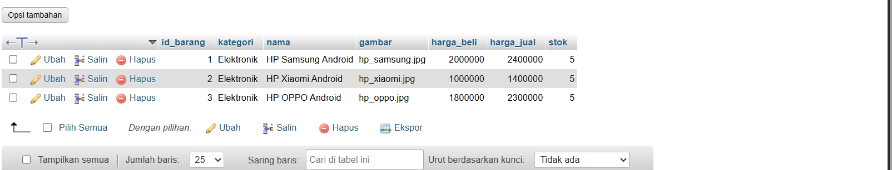
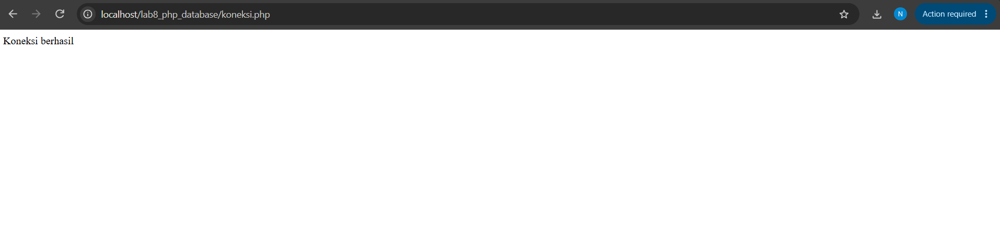
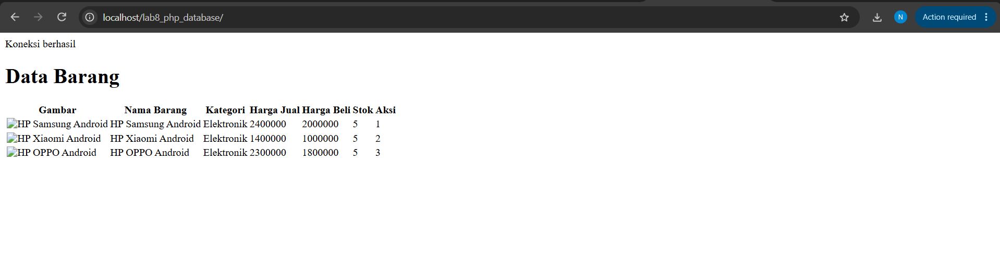
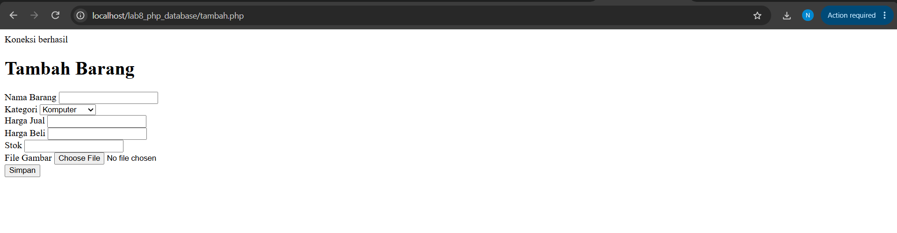
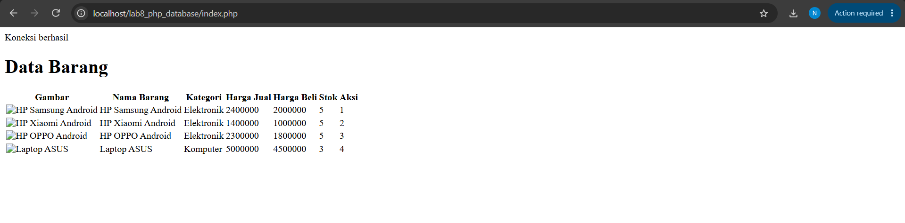
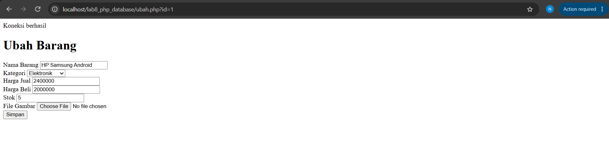
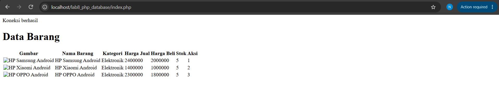

# LAPORAN PRAKTIKUM 8
# PHP DAN DATABASE MYSQL

## IDENTITAS MAHASISWA

- **Nama:** Nadya Nisaqilah Putri Budiman
- **NIM:** 312510191
- **Mata Kuliah:** Pemrograman Web
- **Nomor Praktikum:** 8
- **Topik:** PHP dan Database MySQL
- **Program Studi:** Teknik Informatika

---

## A. TUJUAN PRAKTIKUM

Praktikum ini bertujuan untuk:

1. Memahami konsep dasar Database.
2. Memahami konsep dasar CRUD menggunakan PHP.
3. Membuat program CRUD sederhana menggunakan PHP dan MySQL.

## B. PERANGKAT YANG DIGUNAKAN

Perangkat yang digunakan dalam praktikum ini adalah:

1. Laptop dengan sistem operasi Windows 11.
2. XAMPP sebagai web server lokal.
3. PHP sebagai bahasa pemrograman server-side.
4. MySQL sebagai sistem manajemen database.
5. phpMyAdmin untuk mengelola database.
6. Visual Studio Code sebagai editor kode.
7. Google Chrome sebagai web browser.

## C. CARA MENJALANKAN SERVER LOKAL

Langkah-langkah menjalankan project:

1. Membuka aplikasi XAMPP Control Panel.
2. Menekan tombol **Start** pada module Apache dan MySQL.
3. Memastikan folder `lab8_php_database` berada di dalam folder `D:\xampp\htdocs`.
4. Membuka folder project menggunakan Visual Studio Code.
5. Membuka browser Google Chrome.
6. Memasukkan alamat berikut:

   `http://localhost/lab8_php_database/`

7. Untuk mengakses database, membuka alamat:

   `http://localhost/phpmyadmin/`

8. Memastikan database `latihan1` dan tabel `data_barang` sudah tersedia.

Program PHP harus dijalankan melalui server lokal agar dapat terhubung dengan database MySQL.

## D. STRUKTUR FOLDER PROYEK

```text
lab8_php_database/
│
├── koneksi.php
├── index.php
├── tambah.php
├── ubah.php
├── hapus.php
├── style.css
├── README.md
│
├── gambar/
│
└── screenshot/
    ├── databarang.png
    ├── formtambahbarang.png
    ├── formubahbarang.png
    ├── koneksidatabase.png
    ├── tampilandatabarang.png
    ├── tampiltambahbarang.png
    └── hapusdatabarang.png
```

## E. DOKUMENTASI HASIL PRAKTIKUM

### 1. MEMBUAT DATABASE MYSQL

Pada tahap pertama, menjalankan Apache dan MySQL melalui XAMPP Control Panel. Selanjutnya membuka phpMyAdmin melalui browser dan membuat database dengan nama `latihan1`.

Setelah database dibuat, database tersebut digunakan sebagai tempat penyimpanan data barang.

**Hasil:** Database `latihan1` berhasil dibuat melalui phpMyAdmin.

### 2. MEMBUAT TABEL DATA BARANG

Setelah database dibuat, selanjutnya membuat tabel dengan nama `data_barang` yang terdiri dari tujuh kolom, yaitu:

| Nama Kolom | Tipe Data |
|---|---|
| id_barang | int(10) |
| kategori | varchar(30) |
| nama | varchar(30) |
| gambar | varchar(100) |
| harga_beli | decimal(10,0) |
| harga_jual | decimal(10,0) |
| stok | int(4) |

Kolom `id_barang` digunakan sebagai Primary Key dan menggunakan Auto Increment.

**Hasil:** Tabel `data_barang` berhasil dibuat di dalam database `latihan1`.



### 3. MEMBUAT KONEKSI DATABASE

Membuat file `koneksi.php` untuk menghubungkan program PHP dengan database MySQL.

Konfigurasi koneksi yang digunakan:

- Host: localhost
- Username: root
- Password: kosong
- Database: latihan1

Koneksi database dibuat menggunakan fungsi `mysqli_connect()`.

**Hasil:** PHP berhasil terhubung dengan database MySQL.



### 4. MENAMPILKAN DATA BARANG (READ)

Membuat file `index.php` untuk menampilkan seluruh data barang yang tersimpan di dalam tabel `data_barang`.

Pengambilan data menggunakan perintah SQL `SELECT` dan hasilnya ditampilkan dalam bentuk tabel pada halaman web.

Informasi yang ditampilkan meliputi gambar, nama barang, kategori, harga jual, harga beli, stok, dan aksi.

**Hasil:** Data barang berhasil ditampilkan pada halaman utama website.



### 5. MENAMBAHKAN DATA BARANG (CREATE)

Membuat file `tambah.php` untuk menambahkan data barang baru ke dalam database.

Form tambah barang terdiri dari beberapa input:

- Nama barang.
- Kategori.
- Harga jual.
- Harga beli.
- Stok.
- File gambar.

Data yang dimasukkan akan diproses menggunakan PHP dan disimpan ke dalam database MySQL.

**Hasil Form Tambah Barang:**



**Hasil Setelah Menambahkan Barang:**



### 6. MENGUBAH DATA BARANG (UPDATE)

Membuat file `ubah.php` untuk mengubah data barang yang sudah tersimpan di dalam database.

Data barang dipilih berdasarkan `id_barang`. Setelah data yang ingin diubah ditampilkan pada form, pengguna dapat memperbarui informasi barang.

Proses perubahan data menggunakan perintah SQL `UPDATE`.

**Hasil:** Form perubahan data barang berhasil dibuat dan digunakan untuk mengubah informasi barang.



### 7. MENGHAPUS DATA BARANG (DELETE)

Membuat file `hapus.php` untuk menghapus data barang berdasarkan `id_barang`.

Proses penghapusan menggunakan perintah SQL `DELETE`. Setelah data berhasil dihapus, halaman akan diarahkan kembali ke halaman utama.

**Hasil:** Data barang berhasil dihapus dari database.



## F. HASIL PENGUJIAN CRUD

Berdasarkan latihan yang telah dilakukan, pengujian program meliputi:

### 1. CREATE (MENAMBAHKAN DATA)

Pengujian dilakukan dengan memasukkan data barang baru melalui form tambah barang.

**Hasil:** Data barang berhasil ditambahkan dan disimpan ke dalam database.

### 2. READ (MENAMPILKAN DATA)

Pengujian dilakukan dengan membuka halaman utama untuk melihat data barang yang tersimpan.

**Hasil:** Data barang berhasil ditampilkan dalam bentuk tabel.

### 3. UPDATE (MENGUBAH DATA)

Pengujian dilakukan dengan memilih data barang dan mengubah informasi melalui form ubah barang.

**Hasil:** Data barang dapat diperbarui sesuai perubahan yang dilakukan.

### 4. DELETE (MENGHAPUS DATA)

Pengujian dilakukan dengan menghapus data barang berdasarkan ID barang.

**Hasil:** Data barang berhasil dihapus dari database.

## G. KESIMPULAN

Berdasarkan seluruh kegiatan Praktikum 8, dapat disimpulkan bahwa PHP dapat digunakan untuk mengelola data yang tersimpan di dalam database MySQL.

Melalui praktikum ini, dapat dipahami cara membuat database, membuat tabel, menghubungkan PHP dengan MySQL, serta mengolah data menggunakan konsep CRUD (Create, Read, Update, Delete).

Dengan adanya program CRUD sederhana, proses penambahan, penampilan, perubahan, dan penghapusan data barang dapat dilakukan melalui halaman web.

Praktikum ini memberikan pemahaman dasar mengenai penggunaan PHP dan MySQL dalam membangun aplikasi web yang terhubung dengan database.

---

**Dokumentasi hasil praktikum disimpan dalam folder `screenshot` pada direktori proyek `lab8_php_database`.**
